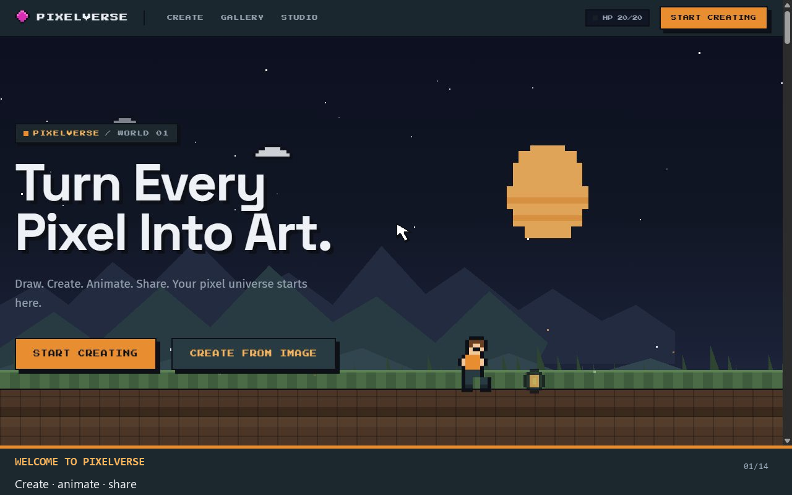
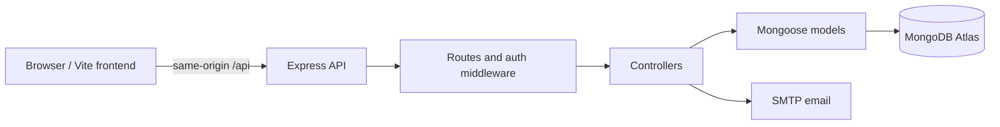

# 🎮 PixelVerse

### Evaluation 2 · Draw pixels. Animate frames. Share your art.

`Vite` · `Express 5` · `MongoDB Atlas` · `Vercel` · `Postman`

**[🚀 Launch the live app](https://pixelverse-evaluation-2.vercel.app)** · **[🎨 Open the editor](https://pixelverse-evaluation-2.vercel.app/blank.html)** · **[🖼️ Explore the Gallery](https://pixelverse-evaluation-2.vercel.app/gallery.html)** · **[▶️ Watch the tour](https://pixelverse-evaluation-2.vercel.app/tutorial/pixelverse-tour-evaluation-2.mp4)**

PixelVerse is a browser-based pixel art studio with drawing tools, frame animation, image references, local recovery, cloud projects, publishing, a Gallery, and artist profiles. The repository keeps the **frontend and Express/MVC backend together** with MongoDB models, tests, a Postman collection, and the Evaluation 2 tutorial.

| Live destination | What you can try |
| --- | --- |
| [Home](https://pixelverse-evaluation-2.vercel.app) | Explore the project and start creating |
| [Editor](https://pixelverse-evaluation-2.vercel.app/blank.html) | Draw, animate, save, and publish |
| [Gallery](https://pixelverse-evaluation-2.vercel.app/gallery.html) | Browse artwork and artist profiles |
| [Guides](https://pixelverse-evaluation-2.vercel.app/guides.html) | Follow walkthroughs and video chapters |
| [Privacy](https://pixelverse-evaluation-2.vercel.app/privacy.html) · [Terms](https://pixelverse-evaluation-2.vercel.app/terms.html) | Read the public policy and service pages |
| [API health](https://pixelverse-evaluation-2.vercel.app/api/health) | Check the deployed API and database connection |

> [!NOTE]
> Drawing and local saves work without an account. Cloud saving, publishing, and social actions need a verified account. The browser uses same-origin `/api` requests; MongoDB credentials stay on the server.

## Contents

- [Features](#features)
- [Try the main flows](#try-the-main-flows)
- [Architecture](#architecture)
- [Project structure](#project-structure)
- [Run locally](#run-locally)
- [Configuration](#configuration)
- [Pages and user flows](#pages-and-user-flows)
- [API overview](#api-overview)
- [Data and security](#data-and-security)
- [Tests and build](#tests-and-build)
- [Postman walkthrough](#postman-walkthrough)
- [Tutorial video](#tutorial-video)
- [Deployment notes](#deployment-notes)
- [Troubleshooting](#troubleshooting)

## Features

| Area | What it does |
| --- | --- |
| Drawing | Pixel canvas with pencil, eraser, fill, picker, palettes, grid sizes, undo and redo |
| Animation | Multiple frames, timeline, Studio playback, and export controls |
| Image reference | Converts an uploaded image into a pixel reference to trace or compare |
| Local work | Browser autosave, recovery copies, replay, JSON export, and image or animation export |
| Accounts | Email verification, sign-in, password reset, Google sign-in or linking when configured, and sessions |
| Cloud projects | Private create, list, open, update, and delete operations tied to the signed-in owner |
| Publishing | Fixed artwork snapshot with title, description, tags, cover frame, and visibility |
| Gallery | Public and trending feeds, search, artwork detail, saved art, reactions, comments, and reports |
| Artist profiles | Searchable usernames, bio, avatar and featured art, follows, Following feed, and activity |
| Help | Guides, interactive tours, Contact form, and Evaluation 2 video with captions and chapters |

Drawing and local saving work without an account. Cloud saving, publishing, follows, saved art, reactions, comments, and activity require a verified account and a connected API.

**Where your work lives**

| Kind of work | Stored in | Who can access it |
| --- | --- | --- |
| Local drawing and recovery | This browser | The person using that browser profile |
| Cloud project | MongoDB through the API | Its signed-in owner |
| Published artwork | A separate Gallery snapshot in MongoDB | According to its public, unlisted, or private visibility |

Updating a cloud project does not silently change an artwork that was already published.

## Try the main flows

1. **Create:** Open the [editor](https://pixelverse-evaluation-2.vercel.app/blank.html), choose a grid, draw with pencil/fill/eraser, and add frames. Studio plays the animation.
2. **Keep your work:** Save in the browser or export it. Sign in to save a private cloud project that you can reopen on another device.
3. **Share:** Publish a fixed artwork copy with a title, tags, cover frame, and visibility. Find it in the [Gallery](https://pixelverse-evaluation-2.vercel.app/gallery.html), then visit its artist profile.

The [Evaluation 2 tour](https://pixelverse-evaluation-2.vercel.app/tutorial/pixelverse-tour-evaluation-2.mp4) demonstrates these flows with captions and chapter links on the [Guides page](https://pixelverse-evaluation-2.vercel.app/guides.html).

## Architecture

- **Frontend:** HTML, CSS, browser JavaScript modules, and Vite.
- **Backend:** Node.js, Express 5, Mongoose, and MongoDB.
- **Authentication:** salted password hashes, server-verified Google identity tokens when configured, access tokens, and a server-side session with a refresh cookie.
- **Email:** Nodemailer for verification, password reset, and Contact messages.
- **Tests:** Node's built-in test runner and a Postman collection.

The MVC organization separates Mongoose schemas in `backend/models/` (**models**), browser pages and modules in `frontend/` (**views**), request handlers in `backend/controllers/` (**controllers**), and HTTP method, path, authentication, and rate-limit declarations in `backend/routes/`. `backend/routes/index.js` mounts the API. `backend/auth.js` re-exports account helpers used by existing integrations.

Locally, `backend/index.js` starts Express. On Vercel, `api/index.js` exposes the same app through one serverless function. The `/api/:path*` rewrite in `vercel.json` restores nested Express routes.

Publishing creates a separate artwork snapshot. Editing its source canvas later does not change the Gallery post.

## Project structure

This is a map of the main source and support files, grouped by purpose rather than every small module.

~~~text
pixelverse/
|-- frontend/                         # Browser app that Vite builds
|   |-- index.html                    # Landing page and video
|   |-- blank.html                    # Blank canvas and Studio
|   |-- image.html                    # Image reference workflow
|   |-- gallery.html                  # Gallery and artist profiles
|   |-- guides.html                   # Help and video chapters
|   |-- contact.html                  # Contact form
|   |-- privacy.html, terms.html      # Public policy and service pages
|   |-- google-bridge.html            # Google sign-in return flow
|   |-- css/
|   |   |-- base.css, components.css, tablet.css
|   |   |-- components/              # Account, save, replay, onboarding UI
|   |   +-- views/                   # Page-specific styles, including legal.css
|   |-- js/
|   |   |-- main.js, blank.js, image.js, gallery.js
|   |   |-- canvas/                  # Grid, rendering, drawing tools, history
|   |   |-- frames/                  # Frame data and timeline
|   |   |-- animation/               # Playback, export, statistics
|   |   |-- image/                   # Pixelation and palette conversion
|   |   |-- core/                    # State, project codec, storage, API base
|   |   |-- replay/                  # Local replay logic
|   |   +-- views/                   # Editor, Studio, account, save, publish UI
|   +-- public/tutorial/             # Evaluation 2 MP4, poster, captions, chapters
|-- backend/
|   |-- app.js                        # Express middleware and route mounting
|   |-- index.js                      # Local API server and MongoDB setup
|   |-- config.js                     # Server environment configuration
|   |-- auth.js                       # Compatibility exports for account helpers
|   |-- mail.js                       # Account and Contact email delivery
|   |-- models/
|   |   |-- index.js                  # Mongoose schemas and indexes
|   |   +-- projectValidation.js      # Saved canvas validation
|   |-- controllers/                 # Account, project, Gallery, Contact, notification, health handlers
|   |-- routes/                      # HTTP paths, auth middleware, rate limits, route mounting
|   +-- projectSnapshot.js           # Freeze and thumbnail publications
|-- api/index.js                      # Vercel function entry for Express
|-- scripts/                          # Local startup, moderation, and data migration
|-- tests/                             # Unit and database integration tests
|-- postman/
|   +-- PixelVerse-Evaluation-2.postman_collection.json
|-- package.json, package-lock.json
|-- vite.config.js
|-- vercel.json, render.yaml           # Deployment configuration
|-- EVALUATION_2.md                    # Presentation and MVC walkthrough
+-- README.md
~~~

**Vite's root is frontend/**. The obsolete duplicate browser files at the repository root were removed so the source tree contains one browser app. dist/ is generated by the build and ignored by Git.

## Run locally

### Prerequisites

- Node.js 20 or newer and npm. The current project was checked with Node.js 22.
- MongoDB Community Server running locally, or a MongoDB Atlas connection string.
- SMTP settings for email registration, verification, password reset, and Contact.
- A Google OAuth client ID only if Google sign-in is needed.

### 1. Install dependencies

~~~powershell
npm ci
~~~

### 2. Create a private environment file

Create .env in the repository root. Minimal local settings:

~~~dotenv
PORT=4000
MONGO_URI=mongodb://127.0.0.1:27017/pixelverse
JWT_SECRET=<replace-with-a-unique-private-value-of-at-least-32-characters>
CLIENT_ORIGINS=http://127.0.0.1:5173
APP_ORIGIN=http://127.0.0.1:5173/blank.html
~~~

Replace the JWT_SECRET placeholder with your own random value. Do not commit .env. For Atlas, set MONGO_URI to the server connection string in that private file. Email and Google features need the additional variables below.

### 3. Start the app

~~~powershell
npm run dev
~~~

Open http://127.0.0.1:5173/. The development launcher expects .env, starts MongoDB for a local URI if it is not already listening, starts the API on port 4000, and starts Vite on port 5173. On Windows it looks for mongod.exe under C:\Program Files\MongoDB\Server; on other systems mongod must be on PATH. It reuses a healthy PixelVerse API or website already occupying the expected port.

For separate processes, use npm run dev:api and npm run dev:web. The web-only command needs an API at http://127.0.0.1:4000 unless PIXELVERSE_API_PROXY points elsewhere.

### npm scripts

| Command | Purpose |
| --- | --- |
| npm run dev | Start local MongoDB when needed, the API, and the website |
| npm run dev:lan | Start the same development stack with the website reachable on the local network |
| npm run dev:web | Start only Vite, selecting the supported local web port |
| npm run dev:api | Start the API with Node watch mode |
| npm run build | Build the frontend into dist/ |
| npm run start:api | Start the persistent API server without watch mode |
| npm test | Run unit tests and any configured database integration tests |
| npm run seed:gallery | Add example artwork to a **local development MongoDB only** |
| npm run moderator -- --grant email@example.com | Grant a verified account moderation access; --revoke reverses it |

## Configuration

| Variable | Purpose |
| --- | --- |
| PORT | Express port; defaults to 4000 |
| MONGO_URI | MongoDB connection string |
| MONGO_USER, MONGO_PASSWORD, MONGO_HOST, MONGO_DB | Alternative pieces used to build an Atlas URI when MONGO_URI is absent |
| JWT_SECRET | Private signing secret; at least 32 characters |
| CLIENT_ORIGINS | Comma-separated exact browser origins allowed by CORS |
| APP_ORIGIN | Base URL used in email links |
| GOOGLE_CLIENT_ID | Enables Google sign-in; required by production validation |
| SMTP_URL | Complete mail transport URL, or use the SMTP settings below |
| SMTP_HOST, SMTP_PORT, SMTP_USER, SMTP_PASS | SMTP transport settings; port defaults to 465 |
| MAIL_FROM | Sender address for verification, reset, and Contact mail |
| CONTACT_TO | Contact inbox; defaults to SMTP_USER when omitted |
| PIXELVERSE_API_PROXY | Optional Vite /api proxy target; defaults to http://127.0.0.1:4000 |
| MONGO_TEST_URI | Optional disposable MongoDB URI used by integration tests |

Email sign-up is available only when mail delivery, JWT signing, and MongoDB are ready. For production, backend/productionCheck.js also requires HTTPS APP_ORIGIN and CLIENT_ORIGINS. Keep all credentials in private environment settings.

## Pages and user flows

| Page | Typical flow |
| --- | --- |
| / or /index.html | Explore the app, watch the Evaluation 2 tour, open drawing or Gallery |
| /blank.html | Draw, add frames, use Studio, save locally or to cloud, publish |
| /image.html | Upload an image, convert it to a pixel reference, then draw |
| /gallery.html | Browse and search artwork, view profiles, follow artists, react, comment |
| /guides.html | Read task guides, play video chapters, launch interactive guides |
| /contact.html | Send a support message when SMTP is configured |
| /privacy.html and /terms.html | Read privacy and service terms; both direct questions to Contact |

Local editor data is stored in the browser. Private cloud projects are stored in MongoDB and require authentication. Gallery publication stores its own fixed snapshot with public, unlisted, or private visibility. Public profiles show public artwork and do not expose account email addresses.

## API overview

All endpoints use the /api prefix. JSON requests and responses use the same Express app locally and through api/index.js on Vercel.

| Endpoint | Purpose |
| --- | --- |
| GET /api/health | Returns 200 with database: connected, or 503 when disconnected |
| GET /api/auth/config | Shows which sign-in options are configured |
| POST /api/auth/register | Create an email account and send a verification message |
| POST /api/auth/verify | Verify that account using the emailed token |
| POST /api/auth/login | Sign in with email and password |
| POST /api/auth/google | Server-verifies a Google identity token |
| POST /api/auth/refresh | Renew the access token using the refresh session |
| POST /api/auth/logout | Revoke the current session |
| GET /api/projects | List the signed-in owner's private projects |
| POST /api/projects | Create a private project |
| GET /api/projects/:id | Read a project owned by the signed-in user |
| PUT /api/projects/:id | Update that project |
| DELETE /api/projects/:id | Delete that project |
| GET /api/gallery | Public feed, search, tag filter, and trending sort |
| POST /api/gallery | Publish a fixed artwork snapshot |
| GET /api/gallery/:id | Open an artwork allowed by its visibility |
| GET /api/gallery/users/search | Find artists by name or username |
| GET /api/gallery/users/:id | Open a public artist profile |
| GET /api/gallery/following | Public art from followed artists |
| GET /api/gallery/saved | Artwork saved by the signed-in user |
| GET /api/notifications | Activity for the signed-in user |
| POST /api/contact | Send a validated, rate-limited Contact message |

The Gallery API also handles follows, bookmarks, reactions, comments, reports, visibility changes, and moderation. See backend/routes/gallery.js for paths and middleware, and backend/controllers/galleryController.js for request bodies and behavior. Project routes all pass through requireAuth and filter records by owner ID.

### Main MongoDB models

User, Session, and OneTimeToken support accounts. Canvas stores private cloud project snapshots. Artwork stores publications. ArtworkBookmark, ArtworkReaction, ArtworkComment, and ArtworkReport support Gallery interactions; ArtistFollow supports profiles and the Following feed. ActivityNotification stores follow, like, and comment events. ModerationAction records moderator decisions. Schemas and indexes live in backend/models/index.js.

## Data and security

- Passwords are salted and hashed; access tokens are verified server-side.
- Refresh tokens are stored in HTTP-only cookies and backed by server-side session records.
- The API validates project data and requires ownership for private project operations.
- Account and Contact endpoints use input validation and rate limits.
- The frontend never receives MONGO_URI, JWT_SECRET, SMTP credentials, or stored password hashes.
- .env files, MongoDB data directories, backups, node_modules/, dist/, and local deployment state are ignored by Git.

## Tests and build

~~~powershell
npm run build
npm test
~~~

The build writes to dist/. The test script runs Node test files sequentially. Without MONGO_TEST_URI, database integration tests are skipped. To exercise them, point MONGO_TEST_URI at a **disposable** database named exactly pixelverse_m2_integration_test. The tests also use derived social and Vercel test database names; the auth and social suites drop their disposable databases. Never use a database containing real data.

The predeployment audit was checked with a clean install, a production build, and all 24 tests passing against disposable local MongoDB. Re-run the commands after changing code or configuration.

## Postman walkthrough

Import the [Evaluation 2 Postman collection](postman/PixelVerse-Evaluation-2.postman_collection.json). It includes ten ordered requests: health, login, unauthenticated project rejection, create, list, read, update, read updated, delete, and confirm deletion.

The collection's baseUrl defaults to `https://pixelverse-evaluation-2.vercel.app`; change it if the Evaluation 2 deployment URL changes. Put a disposable verified account's email and password in **Postman variables only**. The Login test stores an access token, and Create stores the project ID for later requests. Run the collection in order. Keep passwords and tokens out of screenshots and commits.

## Tutorial video

Home and Guides use the [Evaluation 2 tutorial video](https://pixelverse-evaluation-2.vercel.app/tutorial/pixelverse-tour-evaluation-2.mp4) from `frontend/public/tutorial/`. The same folder contains its poster, English captions (`.vtt`), and chapter times (`.json`). Guides uses those chapter times for jump buttons. The video covers drawing, Studio, image references, accounts, cloud saving, publishing, Gallery, and profiles.

## Deployment notes

**Production URL:** [pixelverse-evaluation-2.vercel.app](https://pixelverse-evaluation-2.vercel.app). The [health endpoint](https://pixelverse-evaluation-2.vercel.app/api/health) should return `database: connected` when the API and Atlas are available.

`vercel.json` maps `/api/:path*` to the single `api/index.js` function; `backend/vercelPath.js` restores the Express route path. `backend/index.js` starts a persistent local server. `backend/productionCheck.js` validates production settings. `render.yaml` remains an alternative deployment configuration.

The dedicated Vercel project is `pixelverse-evaluation-2`. Its production variables point to a separate MongoDB Atlas project `pixelverse_2`, cluster `pixelverse-2`, and database `pixelverse_2`. Set `MONGO_URI`, `JWT_SECRET`, `CLIENT_ORIGINS`, `APP_ORIGIN`, `GOOGLE_CLIENT_ID`, `SMTP_HOST`, `SMTP_PORT`, `SMTP_USER`, `SMTP_PASS`, `MAIL_FROM`, and `CONTACT_TO` in Vercel; never commit their secret values. The new Atlas database received 90 existing Evaluation 2 documents across 12 model collections. The one-time copy was verified by document counts and hashes in [GitHub Actions run 40370714354](https://github.com/SakshamSekhri/MERN-PROJECT-/actions/runs/40370714354). The temporary Actions secrets and workflow were removed after migration. `scripts/migrate-evaluation-2-data.mjs` remains for audit and controlled recovery.

This Vercel project was deployed from the linked checkout with Vercel CLI. A GitHub push does **not** automatically update the live site; deploy the intended commit to the linked `pixelverse-evaluation-2` project and verify the production URL afterward. Google Sign-In also needs the production URL in the Google OAuth client's authorized JavaScript origins, and its audience must include the people who should sign in.

## Troubleshooting

| Symptom | Check |
| --- | --- |
| `/api/health` returns 503 | Confirm `MONGO_URI`, the Atlas database user, and the Atlas network access list. |
| Email registration or Contact is unavailable | Confirm SMTP variables and `MAIL_FROM`; check the API response and server logs. |
| Google button says the origin is not allowed | Add the exact deployed origin to the OAuth client's authorized JavaScript origins. |
| Postman returns 401 for project requests | Log in first with a verified disposable account and run the collection in order. |
| A GitHub change is missing from the live site | Check which commit was deployed to the linked Vercel project; pushing alone does not deploy this project. |

For a short presentation path and MVC talking points, see [EVALUATION_2.md](EVALUATION_2.md).
